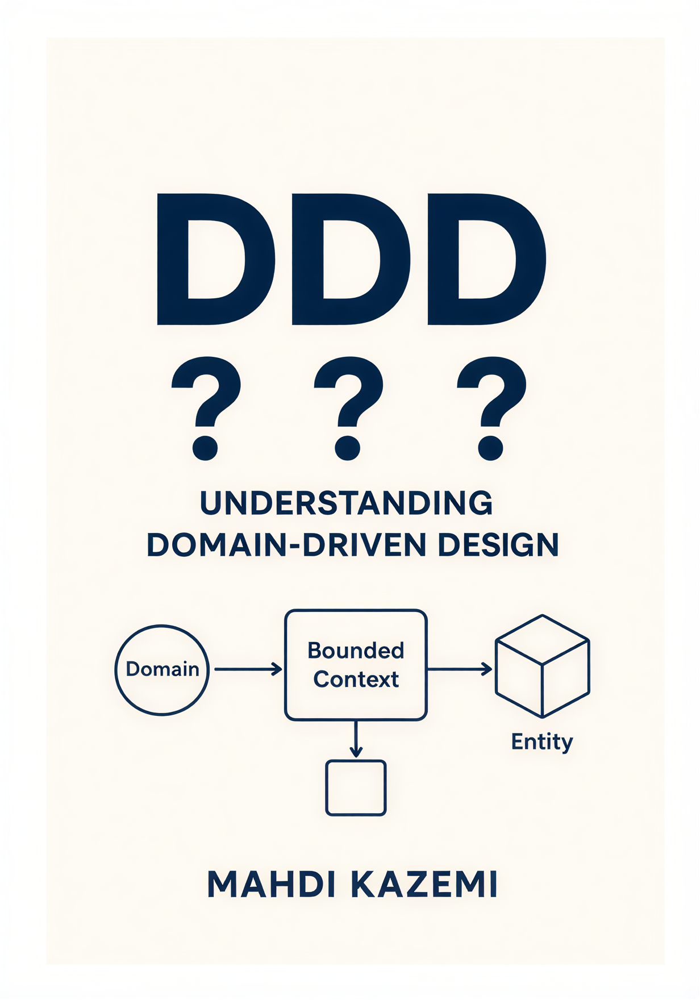

  

<h1 align="center">🚀 راهنمای جامع Understanding Domain-Driven Design (DDD)</h1>

  <strong>مقدمه‌ای شفاف و کاربردی بر طراحی دامنه‌محور (DDD)، طراحی استراتژیک، کانتکست‌های محدود و معماری تاکتیکال</strong>

  

  

  

  

  

  

---

## 💡 چرا این پروژه؟

مجموعه آموزشی **Understanding Domain-Driven Design** تألیف *مهدی کاظمی* ([LinkedIn](https://www.linkedin.com/in/mahdi-kazemi-career) | [GitHub](https://github.com/mahdikazemi96))، یکی از دقیق‌ترین منابع فارسی برای درک معماری دامنه‌محور (DDD)، کشف دامنه و طراحی سیستم‌های پیچیده سازمانی است.

هدف ما در این پروژه اوپن‌سورس:
* 🎯 **ارائه ساختاریافته و خوانا** از مفاهیم طراحی استراتژیک، Bounded Contextها و معماری تاکتیکال
* 💻 **قالب‌بندی استاندارد کدها و دیاگرام‌ها** در Markdown برای مطالعه سریع در گیت‌هاب و وب
* 🌍 **سهولت دسترسی و مشارکت جامعه مهندسان نرم‌افزار** با حفظ کامل حقوق معنوی نویسنده

---

  ## ⚡ دسترسی سریع

| مرجع | توضیحات | لینک |
| :--- | :--- | :---: |
| 📖 **نسخه وب (گیتاب)** | تجربه خواندن تعاملی با پوسته تاریک/روشن و جستجوی سریع | [ورود به گیتاب ↗](https://hheydarian.github.io/Gitab/books/book8/) |
| 📥 **فصل‌های کتاب (Markdown)** | مشاهده و مطالعه مستقیم فایل‌های فارسی در پوشه فصل‌ها | [مشاهده پوشه Book ↗](Book/) |
| 👤 **گیت‌هاب نویسنده اثر** | صفحه گیت‌هاب مهدی کاظمی (مؤلف مقاله مرجع DDD) | [پروفایل مهدی کاظمی ↗](https://github.com/mahdikazemi96) |

---

## 🔍 راهنمای خوانایی بهتر در گیت‌هاب

برای اینکه متون فارسی در گیت‌هاب و مرورگر با خط استاندارد و چشم‌نواز نمایش داده شوند:
1. افزونه رایگان **[فونت ایران (FontIran)](https://chromewebstore.google.com/detail/fontiran/edbchgkbejkdkdkpgenlaciegoidmjoh)** را روی مرورگر نصب کنید.
2. فونت پیش‌فرض را روی **وزیرمتن (Vazirmatn)** یا **ایران‌یکان** قرار دهید تا خوانایی کدها و متن به اوج برسد.

---

## 📚 فهرست سرفصل‌ها

تمامی **۶ بخش اصلی** این راهنمای جامع با ساختار منظم آماده مطالعه است:

| شماره | نام سرفصل (انگلیسی) | عنوان فارسی | وضعیت | مطالعه مستقیم |
| :---: | :--- | :--- | :---: | :---: |
| **01** | DDD Fundamentals | مبانی و مفاهیم اولیه DDD | ✅ | [مطالعه فصل](Book/01/DDD-Fundamentals.md) |
| **02** | Strategic Design: Subdomains | طراحی استراتژیک: شناخت ساب‌دامین‌ها | ✅ | [مطالعه فصل](Book/02/Strategic-Design-Subdomains.md) |
| **03** | Bounded Contexts & Relationships | کانتکست‌های کران‌دار و روابط بین آن‌ها | ✅ | [مطالعه فصل](Book/03/Bounded-Contexts-and-Relationships.md) |
| **04** | Domain Discovery & Distillation | کشف دامنه و سند چشم‌انداز | ✅ | [مطالعه فصل](Book/04/Domain-Discovery-and-Distillation.md) |
| **05** | Tactical Design & Architecture | طراحی تاکتیکال و معماری فنی | ✅ | [مطالعه فصل](Book/05/Tactical-Design-Architecture.md) |
| **06** | Conclusion & Roadmap | جمع‌بندی و مسیر پیش‌رو | ✅ | [مطالعه فصل](Book/06/Conclusion-and-Roadmap.md) |

---

## 🤝 مشارکت در پروژه (Contributions Welcome)

این یک پروژه اجتماعی متعلق به تمام توسعه‌دهندگان و علاقه‌مندان است. هر تصحیح نگارشی، بهبود در واژه‌گزینی‌های تخصصی یا بهینه‌سازی ساختار متن، ارزش این منبع را دوچندان می‌کند:

1. **فورک کنید (Fork):** ریپازیتوری را فورک کرده و یک برنچ جدید بسازید (`git checkout -b feature/edit-chapter-01`).
2. **اصلاح و بازبینی:** متن یا بخش‌های مورد نظر را اصلاح کنید.
3. **کامیت و ارسال:** تغییرات را ثبت کرده و یک Pull Request تمیز ارسال فرمایید.

> اگر سوال، ابهام یا پیشنهادی درباره مطالب یا ترجمه دارید، خوشحال می‌شویم آن را از طریق بخش **[Issues](https://github.com/hheydarian/Understanding-Domain-Driven-Design/issues)** مطرح کنید.

---

## ⚖️ مجوز و حقوق مالکیت معنوی

* **حقوق معنوی محتوا:** تمامی حقوق مادی و معنوی محتوای این اثر متعلق به نویسنده آن، **مهدی کاظمی** است و این مخزن جهت آرشیو ساختاریافته و سهولت دسترسی جامعه برنامه‌نویسان ایجاد شده است.
* **بازنشر:** استفاده از مطالب با ذکر منبع و نام نویسنده و مطابق شرایط فایل [LICENSE](LICENSE) انجام می‌شود.

---

  ⭐ <strong>اگر این مجموعه و ریپازیتوری برای یادگیری معماری نرم‌افزار برایتان مفید بوده، با دادن یک ستاره (Star) از آن حمایت کنید!</strong> ⭐

  ساخته شده با ❤️ و عشق به توسعه‌دهندگان فارسی‌زبان

